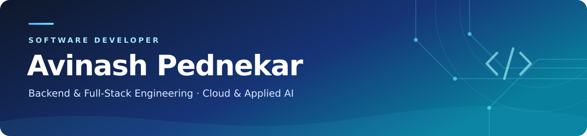

  

  <h1>Hi, I'm Avinash 👋</h1>
  
<strong>Backend &amp; Full-Stack Engineering · Cloud Infrastructure · Applied AI</strong>

  

    
    
    
    
    
  

  

  
<a href="#-about-me">About</a> · <a href="#-featured-projects">Projects</a> · <a href="#-technical-skills">Skills</a> · <a href="#-github-activity--problem-solving">Activity</a> · <a href="#-lets-connect">Contact</a>

---

## 👨‍💻 About Me

Final-year B.Tech Computer Science and Engineering student at **KIT's College of Engineering, Kolhapur**. I build applications that connect backend APIs, databases, cloud infrastructure, and machine learning—from an AWS uptime monitor to an AI recruitment platform and a multimodal deepfake research studio.

**Open to software development internships and entry-level roles**, with a focus on Java/Spring Boot, Python, and full-stack development.

🎓 **Class of 2027** · **CGPA 8.4** · 📍 **Maharashtra, India**

---

## 🚀 Featured Projects

### ☁️ [PulseCheck — Cloud Uptime Monitoring Platform](https://github.com/avipednekar/Pulse-Check)

An end-to-end monitoring project covering application development, infrastructure provisioning, automated delivery, and operational alerts.

- Built scheduled availability and latency checks every **10 minutes**, rolling **24-hour uptime** calculations, REST APIs, and a Chart.js dashboard.
- Provisioned a VPC, public/private subnets, EC2, private RDS PostgreSQL, ECR, and IAM roles using **Terraform**.
- Automated linting, pytest checks, container builds, and EC2 deployment through **GitHub Actions**, with temporary SSH access revoked by a cleanup step.
- Added **CloudWatch and SNS alerts** for CPU utilization and instance health; packaged the application in a non-root Docker image served by Gunicorn.

---

### 🔍 [Multimodal Deepfake Detection Studio](https://github.com/Abhijeet12N/Multimodal-deepfake)

A research application for examining visual manipulation and synthetic speech through multimodal inference and interactive audio diagnostics.

- Combined **Xception facial features**, **Wav2Vec 2.0 speech embeddings**, and a **3D/2D CNN audiovisual compatibility stream** through late fusion, with task-specific video, audio, and overall prediction heads.
- Built a standalone audio scanner with interchangeable **Wav2Vec, AASIST, and AASIST-L** adapters; integrated a fine-tuned AASIST checkpoint selected using validation results.
- Developed a Flask interface with model selection, overlapping-window analysis, timestamped diagnostics, recording scores and thresholds, and linked segment playback.
- Improved preprocessing consistency, preserved model-specific score directions, and added checkpoint/provenance checks and reproducible evaluation reports.

**Recorded benchmark:** **99.69% overall accuracy** and **0.9994 ROC AUC** on a saved FakeAVCeleb test set of **3,276 examples**. These are historical benchmark measurements; the Studio remains a research prototype, with audio generalization and calibration still in progress.

<strong>Evaluation context and current engineering focus</strong>

- The multimodal benchmark is class-imbalanced; overall balanced accuracy is approximately **99.19%**.
- The selected fine-tuned AASIST checkpoint recorded **0.999649 validation ROC AUC** on **10,511 recordings**. Validation performance is separate from held-out deployment performance.
- In an exploratory check of eight reserved, provisionally labeled audio clips, the selected model correctly classified **3/8** and incorrectly flagged all four provisionally genuine clips. This small check exposes transfer limitations; it is not a general accuracy estimate.
- Current priorities are independent recording-level calibration, final held-out audio evaluation, more representative test data, and improved audiovisual alignment.
- The November 2026 project report records **24 Python regression tests** passing for the fine-tuned integration and **17 earlier JavaScript regression tests** for result presentation. These validate software behavior, not detection accuracy.

The project integrates upstream Xception, Wav2Vec 2.0, and AASIST architectures; its contributions center on the application pipeline, model adapters, diagnostics, and evaluation workflow.

---

### 💼 [AI Recruitment Platform](https://github.com/avipednekar/Job-Recruitment)

A recruitment application connecting candidate profiles and resumes with relevant job opportunities.

- Built a **three-service architecture**: React frontend, Node.js/Express API, and a Python/Flask AI service.
- Integrated resume parsing, semantic candidate-job matching, personalized job ranking, and Gemini-powered resume-to-job-description scoring and skill-gap recommendations.
- Implemented **JWT authentication, email-OTP verification, and role-based access** for candidate and recruiter workflows.
- Added application tracking, saved jobs, and recommendation fallbacks when the AI service is unavailable.

---

### 🏦 [Online Banking System](https://github.com/avipednekar/Online-Banking-System)

An educational banking application focused on authentication, transaction integrity, and customer/admin workflows.

- Implemented account management, KYC review, beneficiary verification, transaction history, and approval workflows for higher-value transfers.
- Used **idempotency keys and ordered pessimistic balance locks** to support safe transfer retries and concurrent account updates, with debit/credit ledger records.
- Added JWT access tokens, rotating refresh tokens, **Argon2id password hashing**, role-based authorization, and Flyway-managed schema migrations.

**More work:** [Training & Placement System](https://github.com/avipednekar/Training-Placement) — student, company, and admin workflows with eligibility-based shortlisting and skill matching.

---

## 🛠️ Technical Skills

<table>
  <tr>
    <td><strong>Languages</strong></td>
    <td>
      
      
      </td>
  </tr>
  <tr>
    <td><strong>Backend &amp; APIs</strong></td>
    <td>
      
      
      
       REST APIs · JWT · Role-based access control</td>
  </tr>
  <tr>
    <td><strong>Frontend</strong></td>
    <td>
      
      
      
      </td>
  </tr>
  <tr>
    <td><strong>Databases</strong></td>
    <td>
      
      
      </td>
  </tr>
  <tr>
    <td><strong>Cloud &amp; DevOps</strong></td>
    <td>
      
      
      
       EC2 · VPC · RDS · ECR · IAM · CloudWatch · SNS</td>
  </tr>
  <tr>
    <td><strong>AI &amp; ML</strong></td>
    <td>
      
      
       CNNs · Wav2Vec 2.0 · AASIST integration · Sentence Transformers</td>
  </tr>
  <tr>
    <td><strong>Testing &amp; Tools</strong></td>
    <td>
      
      
      
      
       MockMvc · VS Code · Google Colab · Jupyter Notebook</td>
  </tr>
  <tr>
    <td><strong>CS Fundamentals</strong></td>
    <td>Data Structures &amp; Algorithms · OOP · DBMS · Operating Systems · Computer Networks · SDLC</td>
  </tr>
</table>

## 🎓 Education & Certifications

**B.Tech in Computer Science and Engineering**  
KIT's College of Engineering, Kolhapur · **2023–2027 (expected)** · **CGPA: 8.4**

- ☁️ **AWS Academy Graduate — Cloud Architecting** · September 2026
- 🛡️ **Google Cloud Cybersecurity — Google** · February 2026
- 🤖 **Getting Started with AI — IBM** · July 2026

---

## 📊 GitHub Activity & Problem Solving

  
  
    
  
    
  

---

## 🤝 Let's Connect

Interested in discussing an internship, an entry-level software role, or one of these projects?  
**[Email me](mailto:avinashpednekar431@gmail.com)** or **[connect on LinkedIn](https://linkedin.com/in/avinash-pednekar)**.

   
  

